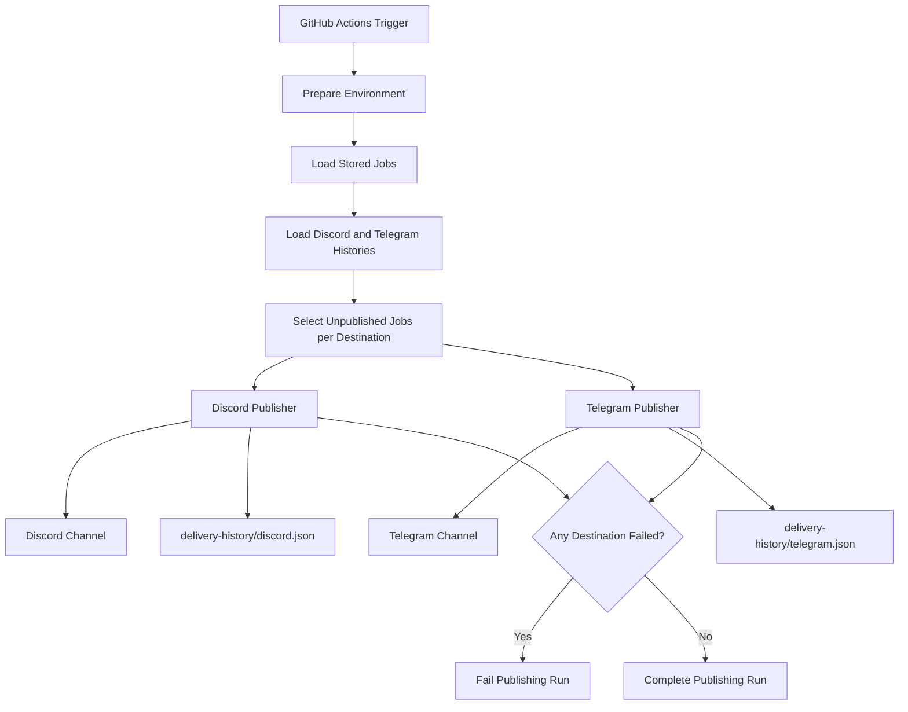
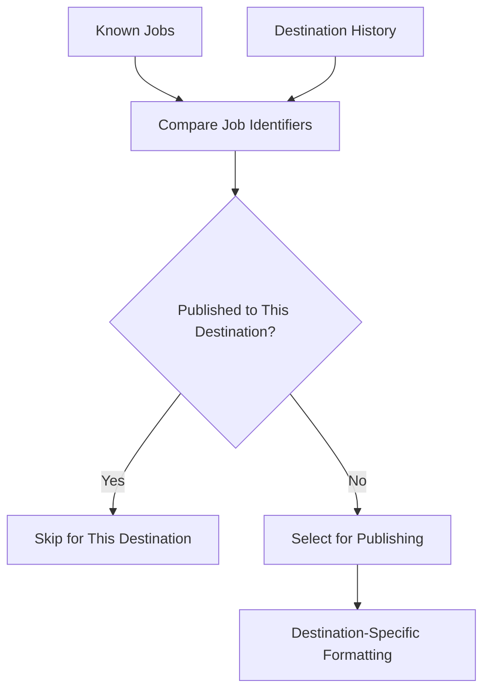
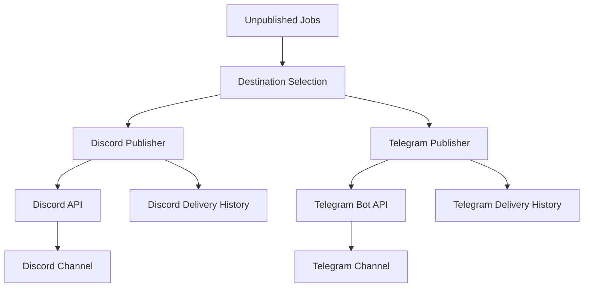
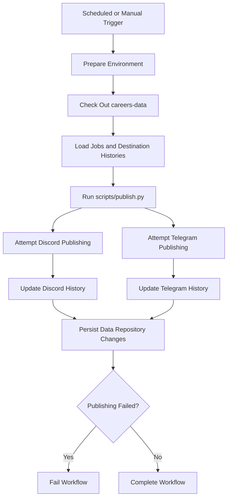

# Publishing Pipeline

The publishing pipeline distributes stored career opportunities to configured publishing destinations.

It operates independently of ingestion. Rather than fetching and parsing external sources, it consumes normalized job records maintained by the ingestion pipeline, identifies jobs that have not yet been published to each destination, formats them for delivery, and maintains destination-specific publication history.

Careers Engine currently supports Discord and Telegram. Each destination has its own publisher and delivery history, allowing the pipeline to track publication independently across channels.

## Pipeline Overview

The publishing pipeline follows these steps:

1. Load normalized jobs and the separate delivery histories from persistent storage.
2. Identify jobs that have not already been published to each destination.
3. Format eligible jobs for the corresponding destination.
4. Attempt delivery through the **Discord** and **Telegram** publishers independently.
5. Record successful deliveries in the corresponding destination history.
6. Report a failed run if either destination encounters an unrecovered failure.

A destination does not depend on the other destination's publication history. A job can therefore be eligible for Telegram even if it has already been published to Discord.

## 1. Input Data

The publishing pipeline consumes the following persistent data from the `careers-data` repository.

| File | Responsibility |
| --- | --- |
| `jobs.json` | Contains normalized job records produced by ingestion. |
| `delivery-history/discord.json` | Tracks jobs successfully published to Discord. |
| `delivery-history/telegram.json` | Tracks jobs successfully published to Telegram. |
| `queue.json` | Stores manually submitted opportunities awaiting processing through the queue workflow. |

Keeping job data separate from destination-specific delivery histories allows the system to distinguish between **discovering a job** and **delivering a job to a particular destination**.

The pipeline evaluates publication eligibility separately for Discord and Telegram. A job already recorded in one destination's history may still need to be published to the other.

## 2. Selecting Unpublished Jobs

Before sending messages, the publishing pipeline compares known jobs against the existing publication history.

The job identifier generated by the canonical `Job` model provides the basis for matching records across runs.

This check makes repeated publishing runs idempotent under normal operating conditions: jobs already recorded as published are not selected again.

If no unpublished jobs are found, the pipeline exits without sending messages or making unnecessary publication-history changes.

### Publication History

The history file maintains the state needed to distinguish published jobs from jobs awaiting publication.

After a successful publication, the corresponding job is recorded in the history so subsequent runs can recognize it.

This state is essential because ingestion and publishing run independently. New jobs can be collected between publishing runs, while previously discovered jobs remain in storage.

## 3. Message Formatting

Normalized job records are designed for consistent application-level processing, not necessarily for direct presentation to users.

Before delivery, each destination's publisher formats selected jobs according to that destination's message requirements. 
Discord and Telegram can use different presentation formats without requiring changes to upstream source adapters or parsers.

**The message can use the available job metadata**, such as:

- Company name.
- Job title.
- Location.
- Application URL.
- Other optional metadata supported by the formatter.

Formatting is kept separate from source parsing. This means the publisher does not need to know whether a job originally came from a Markdown table or a JSON dataset.

As additional publishing channels are introduced, each channel can define its own presentation without requiring upstream parsers to change.

## 4. Destination Publishers

Careers Engine uses separate publishers to deliver opportunities through Discord and Telegram.

### Discord

The Discord publisher uses `discord.py` to interact with the Discord API. Its configuration includes the bot token and target channel ID, and the bot must have sufficient permissions to send messages to the configured channel.

### Telegram

The Telegram publisher uses the Telegram Bot API. Its configuration includes the bot token and target chat ID.

Telegram delivery handles HTTP 429 rate-limit responses using the API's `retry_after` value. It retries a failed request up to five times after the initial attempt, subject to the response containing a valid retry delay.

After each successful Telegram delivery, the corresponding job is recorded in Telegram's publication history immediately. This preserves successful deliveries if a later message in the same run fails.

### Independent Delivery

Discord and Telegram are delivery destinations, not the source of truth for job records. Canonical job data remains in `careers-data`, independently of the messages sent to either channel.

## 5. Persisting Publication State

Publication history must reflect successful delivery rather than merely an attempt to send a message.

Careers Engine maintains separate histories:

- `delivery-history/discord.json`
- `delivery-history/telegram.json`

Each publisher updates the history associated with its destination. Telegram records each successful job immediately after delivery, reducing the risk of losing successful delivery records when a subsequent message fails.

The orchestration attempts delivery to both destinations independently. If either destination fails, the publishing run reports a failure rather than treating the overall run as fully successful.

The manual queue is cleared only when the publishing run completes without destination failures. The workflow also persists updated data-repository state when the publishing step fails, so successful deliveries recorded before a later failure can survive into subsequent runs.

This is not a transactional or exactly-once delivery system. If a destination accepts a message but the application fails before the corresponding history is persisted, a later retry may send that message again.

The publishing process maintains two distinct kinds of state:

- **Job state:** which opportunities the system knows about.
- **Delivery state:** which opportunities have been recorded as successfully published to each destination.

## 6. Automated Execution

GitHub Actions orchestrates the publishing workflow.

The workflow supports scheduled execution and manual triggering. It prepares the environment, checks out the persistent data repository, and executes `scripts/publish.py`.

Publishing is scheduled twice daily at **10:10 AM and 7:10 PM IST**, with a ten-minute offset from the ingestion schedule. This reduces the chance of both workflows attempting to update the shared data repository simultaneously.

The ingestion and publishing workflows are separate:

- **Ingestion** discovers and persists new eligible jobs.
- **Publishing** distributes unpublished stored jobs and records publication state.

This separation allows either workflow to be run independently when needed.

## Design Considerations

The publishing architecture follows several principles:

- **Separation of responsibilities:** Collection and delivery are handled by different pipelines.
- **Destination-specific deduplication:** Independent delivery histories prevent one destination's success from suppressing delivery to another.
- **Destination abstraction:** Each publisher can format and deliver messages according to its destination's requirements.
- **Repeatable execution:** Scheduled and manual runs use the same publishing entry point.
- **Persistent state:** Delivery history survives workflow executions through the separate data repository.
- **Partial-failure handling:** Both destinations are attempted independently, and failures are surfaced rather than silently treated as success.
- **Change-aware persistence:** Updated operational state is committed when changes need to be saved.

## Failure Boundaries and Limitations

Publishing depends on destination availability, valid credentials, configuration, and permissions.

Discord and Telegram are attempted independently; an unrecovered failure causes the publishing run to fail.

Telegram HTTP 429 responses use bounded retries based on the API's `retry_after` value.

Changes to job identifiers can cause previously known opportunities to be treated as new records.

Delivery and history persistence are not transactional, so duplicate messages remain possible after partial failures.

Git-based JSON storage has concurrency and transactional limitations.

Future improvements may include stronger delivery reconciliation and recovery for partial failures.

## Next step

Continue with Storage Architecture to understand how job records and publication history are persisted and shared between the two pipelines.

<Card
  title="Storage Architecture"
  icon="arrow-right"
  href="/architecture/storage"
/>
